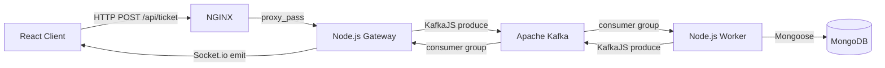

# Distributed Ticketing System

An event-driven backend built with Kafka, WebSockets, and Docker ??? a project I made to understand how microservices actually talk to each other in the real world.

---

## Why I Built This

I got tired of building CRUD apps where the frontend just calls a REST endpoint and waits. I wanted to understand what happens when you throw a message broker in the middle and decouple your services.

So I built this: a ticket purchase flow where the frontend fires a request, Kafka queues it, a background worker processes it, and a WebSocket pushes the result back ??? all without the browser polling for updates.

This was a learning project. It helped me understand event-driven architecture, consumer groups, Docker networking, and why reverse proxies matter.

---

## Architecture



**How it works:**

1. User clicks "Purchase Ticket" in the React app
2. NGINX forwards the request to the Gateway
3. Gateway pushes a message to the `ticket_request` Kafka topic
4. Worker consumes the message, saves a ticket to MongoDB, and publishes to `ticket_completed`
5. Gateway consumes the completion event and broadcasts it to the browser via Socket.io
6. React updates the UI in real-time ??? no refresh needed

---

## Tech Stack

- **Runtime:** Node.js
- **HTTP Framework:** Express
- **Message Broker:** Apache Kafka (KRaft mode, single-node)
- **Kafka Client:** KafkaJS
- **Real-time:** Socket.io
- **Database:** MongoDB
- **Reverse Proxy:** NGINX
- **Containerization:** Docker, Docker Compose
- **Orchestration:** Kubernetes (Minikube) ??? optional, for local cluster testing
- **Load Testing:** Native Node.js `fetch` with chunked concurrency

---

## Local Setup

**Prerequisites:**
- Docker Desktop (or Docker Engine)
- At least 4-6 GB of free RAM ??? Kafka is memory-hungry

```bash
# Clone the repo
git clone https://github.com/Mechtech001/distributed-ticket-service.git
cd distributed-ticket-service

# Start everything
docker compose up -d

# Check that all services are running
docker compose ps
```

The frontend will be available at `http://localhost:5173`.

---

## What I Learned

- **Kafka consumer groups confused me at first.** Getting the consumer to pick up messages from the right topic, with the right group ID, and handling the case where the broker isn't ready yet ??? that took some trial and error.

- **Docker networking is not intuitive.** Services can't reach each other by `localhost`. I spent a lot of time figuring out why `curl` worked inside a container but the browser couldn't connect. Turns out, `localhost` inside Docker is the container itself, not the host.

- **NGINX reverse proxy setup was tricky.** Especially the WebSocket upgrade headers for Socket.io. Without the right `Upgrade` and `Connection` headers, nginx silently drops the connection.

- **Kafka's default replication factor broke everything on a single node.** I had to explicitly set `KAFKA_OFFSETS_TOPIC_REPLICATION_FACTOR=1` and similar configs, or the Group Coordinator would never initialize.

---

## Future Roadmap

- There are Kubernetes manifests in `k8s/` for running this on Minikube. I set up deployments for each service with proper environment variables. Someday I want to try scaling the worker horizontally and see how Kafka distributes the load.

- Right now I'm focusing on Data Structures and Algorithms prep, so this project is mostly in maintenance mode. But it was a solid exercise in understanding how real backend systems are wired together.

---

## License

MIT - see [LICENSE](LICENSE).

